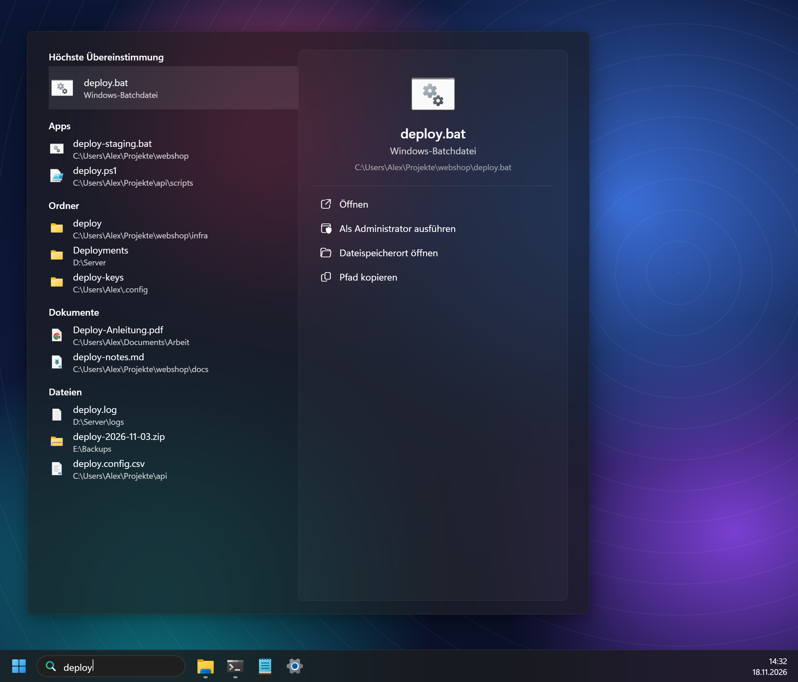
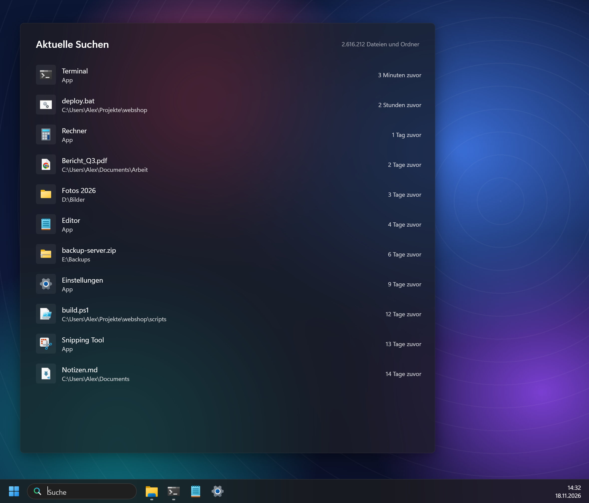
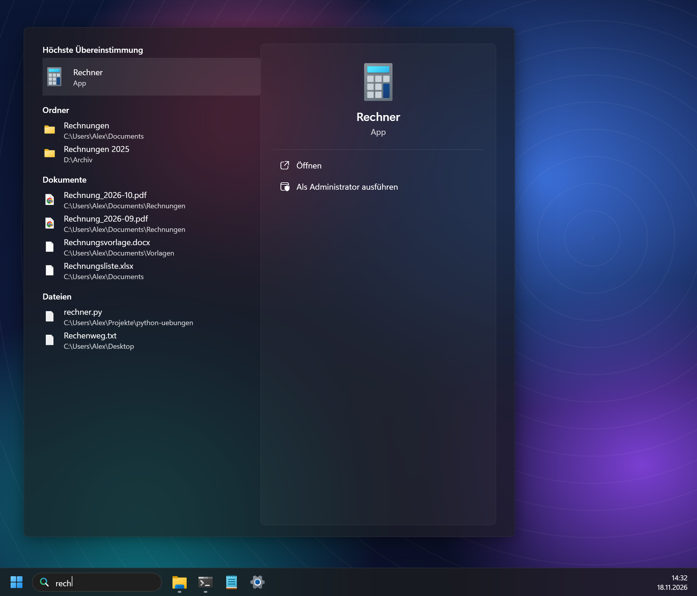

# Blitzsuche: instant file search for the Windows 11 taskbar

**Replaces the Windows 11 taskbar search with a lightning-fast "search everything" tool that finds every file and folder on every drive.** Written in Rust. The UI looks just like the native Windows 11 search flyout.

> *Blitzsuche* is German for "lightning search". The interface is in German.



| Recent items | Apps and documents |
|---|---|
|  |  |

<sub>Screenshots use example data.</sub>

Windows Search only looks inside its own index, so a lot of files (scripts, `.bat` files, project folders, anything outside your libraries) never show up. Blitzsuche reads the NTFS file table directly, like *Everything* does. It indexes millions of files in a few seconds and answers every keystroke in milliseconds.

## Features

- **Replaces the taskbar search box.** Clicking the search box in the taskbar or pressing `Win+S` opens Blitzsuche instead of Windows Search.
- **Finds everything on all drives.** It reads the NTFS Master File Table (MFT) through the USN journal. FAT32/exFAT and USB drives are scanned at startup.
- **Fast.** About 2.6 million files indexed in about 3 seconds. Searches take milliseconds, because they run a SIMD substring scan over all names held in memory.
- **Live updates.** New, renamed and deleted files show up immediately through the NTFS USN change journal.
- **Native Windows 11 look.** Acrylic flyout, best match, results grouped into Apps, Folders, Documents, Photos, Videos, Music and Files, and a preview pane with actions.
- **Apps like the Start menu.** Classic and Microsoft Store apps.
- **Recent items.** Things you opened before are listed first.
- **Actions.** Open, run as administrator, open file location, copy path.
- **Lightweight.** Single ~1 MB executable, no installer, no background indexing service.

## Keyboard

| Key | Action |
|---|---|
| `↑` `↓` / `Tab` | select |
| `Enter` | open |
| `Ctrl+Enter` | open file location |
| `Ctrl+Shift+Enter` | run as administrator |
| `Esc` | close |

## Install

Requirements: Windows 11 (Windows 10 should work, not tested), with the WebView2 runtime, which comes preinstalled on Windows 11.

1. Download `blitzsuche.zip` from [Releases](../../releases) and extract it, for example to `C:\Tools\blitzsuche`.
2. Open **PowerShell as administrator** in that folder and run:
   ```powershell
   powershell -ExecutionPolicy Bypass -File .\install.ps1
   ```
   This registers a scheduled task that starts Blitzsuche at logon with administrator rights. Reading the NTFS file table needs admin rights. There is no UAC prompt at each start. Programs you open from Blitzsuche still run with normal user rights, because they are launched through `explorer.exe`.
3. Click the search box in the taskbar.

To uninstall, run `uninstall.ps1` as administrator.

The executable is not code-signed, so Windows SmartScreen may warn you the first time. If you prefer, build it yourself.

## Build from source

```bash
cargo build --release
# copy target/release/blitzsuche.exe to bin/ and run install.ps1 as admin
```

`deploy.sh` rebuilds and restarts the running instance (Git Bash).

## How it works

| Part | How |
|---|---|
| Index (NTFS) | `FSCTL_ENUM_USN_DATA` enumerates the MFT, then `FSCTL_READ_USN_JOURNAL` follows changes live |
| Index (other) | recursive directory scan at startup |
| Search | one lowercase name buffer, `memchr::memmem` SIMD scan, ranking by match type, file type and path |
| Taskbar hook | UI Automation finds the taskbar `SearchButton`; a low-level mouse/keyboard hook intercepts clicks and `Win+S` |
| UI | `tao` + `wry` (WebView2), acrylic via `SetWindowCompositionAttribute` |
| Apps and icons | `shell:AppsFolder`, `IShellItemImageFactory` |

Data (recent items, log) lives in `%LOCALAPPDATA%\Blitzsuche`.

## Status

This works well and is used daily, but it is **not actively maintained**. Issues and pull requests may not get a response. Fork it freely.

---

## Deutsch

**Blitzsuche ersetzt die Windows-11-Taskleistensuche:** Ein Klick aufs Suchfeld oder `Win+S` öffnet eine Suche, die jede Datei auf jedem Laufwerk in Millisekunden findet, im Look der Windows-Suche.

Installation: ZIP aus den Releases entpacken, dann in PowerShell als Administrator `powershell -ExecutionPolicy Bypass -File .\install.ps1` ausführen. Entfernen geht mit `uninstall.ps1`.

## License

MIT, see [LICENSE](LICENSE).
